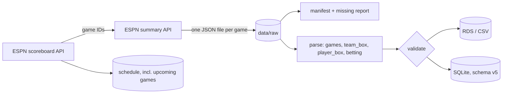

# NBAData

[](https://github.com/kalebcoleman/nba-data/actions/workflows/R-CMD-check.yaml)

An R package that collects NBA game summaries from ESPN's public site API,
parses them into tidy tables, checks them, and stores them as RDS, CSV, or a
versioned SQLite database.

## What it produces

Built locally for the 2021-22 through 2024-25 regular seasons, plus 2025-26
through January 21, 2026:

| Season (ESPN year) | Final games | Not played or no box score |
|---|---:|---:|
| 2022 (2021-22) | 1,231 | 11 |
| 2023 (2022-23) | 1,231 | 1 |
| 2024 (2023-24) | 1,232 | 2 |
| 2025 (2024-25) | 1,234 | 5 |
| 2026 (2025-26, partial) | 656 | 1 |

That is 11,168 team box score rows and 145,252 player box score rows. ESPN's
regular-season listing returns one to four more final games per season than the
1,230-game schedule; I have not checked which games those are.

Validation results on this data:

- Every final game has exactly one home and one away team row, and no duplicate
  keys.
- Team scores match the game scores, and summed player points match team scores.
- One ESPN box score does not add up: game 401704652 (2024-10-25, NO vs POR).
  Field goals, threes, and free throws imply 97 and 91 points against final
  scores of 105 and 103. The validator reports this as a warning.

## Pipeline



1. **Collect.** `collect_raw_season()` gets the season's game IDs from the
   scoreboard endpoint and saves one summary JSON per game. Collection skips
   files that already exist, retries with backoff, and waits `pause_sec`
   (default 0.5s) between requests.
2. **Inventory.** `espn_nba_manifest()` compares expected and collected games
   and writes a manifest and a missing-box-score report.
3. **Parse.** `espn_nba_parse_raw_dir()` turns raw JSON into typed tables using
   one schema map (`.espn_nba_schema()`).
4. **Validate.** `validate_parsed_tables()` runs two kinds of checks:
   - Structural (errors): two team rows and at least one player row per
     completed game, and no duplicate `(game_id, team_id)` or
     `(game_id, athlete_id)` keys.
   - Values (warnings): one home and one away row; points equal
     2·FGM + 3PM + FTM; made ≤ attempted; no negative counts; team score
     matches game score; player points sum to team score.

   Postponed, canceled, and suspended games are excluded, even when ESPN marks
   them completed.
5. **Store.** `write_parsed_tables()` writes RDS, CSV, or upserts into SQLite.
   The database records its schema version in `nbadata_meta`. Migrations run
   inside transactions, so a failed step leaves the previous version intact.

## Setup

Requires R 4.6 or later. Dependencies are pinned with renv.

```r
# from the repository root
renv::restore()
devtools::load_all()   # or devtools::install()
```

On Ubuntu, the packages need `libcurl4-openssl-dev`, `libssl-dev`,
`libxml2-dev`, and `libsqlite3-dev`.

## Usage

Keep a database current during a season (run daily; only new games and the
last few days are fetched):

```r
nba_update()                         # current season, data/sql/nbadata.sqlite
nba_schedule(2027, upcoming_only = TRUE)
nba_team_box(2027)                   # same column names as hoopR::load_nba_team_box()
```

`nba_update()` refreshes the schedule from a few days before the last
completed game through a week ahead, collects any completed games not yet
stored, and refetches the last three days to pick up ESPN's post-game stat
corrections. On the first run for a season it scans from the season start.

Collect, parse, validate, and store a full past season:

```r
out <- collect_parse_store(
  2025,
  raw_dir = "data/raw",
  ingest_db = TRUE,
  db_path = "data/sql/nbadata.sqlite",
  db_mode = "upsert"
)
```

Or step by step:

```r
collect_raw_season(2025, raw_dir = "data/raw")
tables <- espn_nba_parse_raw_dir(2025, raw_dir = "data/raw")
v <- validate_parsed_tables(tables)
v$issues

con <- nba_db_connect(db = "data/sql/nbadata.sqlite")
nba_db_init(con)
write_parsed_tables(tables, format = "sqlite", mode = "upsert", con = con)
nba_db_disconnect(con)
```

Load parsed RDS files into SQLite:

```r
nba_db_ingest_rds(2026, parsed_dir = "data/parsed", db_path = "data/sql/nbadata.sqlite")
```

Write a manifest and missing report for a season:

```r
espn_nba_manifest(2025, season_type = "regular", raw_dir = "data/raw")
```

## Tables

| Table | Grain | Key |
|---|---|---|
| `games` | one row per game | `game_id` |
| `team_box` | two rows per game | `game_id`, `team_id` |
| `player_box` | one row per player per game | `game_id`, `athlete_id` |
| `betting_*` | zero or more rows per game | varies |

The column list and types live in `.espn_nba_schema()` in `R/parse_raw.R`. A
snapshot test fails if the schema changes without a version bump.

## Tests

```r
devtools::test()    # 134 tests; 1 live-API test skipped by default
devtools::check()   # 0 errors, 0 warnings, 0 notes
lintr::lint_package()
```

The tests use saved JSON fixtures and do not call ESPN. To run the live test:

```sh
NBDATA_LIVE=true Rscript -e "testthat::test_file('tests/testthat/test-integration-live.R')"
```

GitHub Actions runs lint and `R CMD check` on every push and pull request.

## Limitations

- ESPN's API is undocumented and can change without notice. Parsers handle
  missing sections, but a renamed field would show up as missing values, not as
  an error.
- Schema versions 1-4 were written during initial development, and each adds
  columns from the current schema, so an old database always ends at the v4
  schema. Version 5 (the `schedule` table) and later list their columns
  explicitly.
- `collect_parse_store()` skips collection when any raw file for the season
  exists, so it is for completed seasons. Use `nba_update()` during a season.
- ESPN's scoreboard endpoint takes one date per request, so a full-season
  schedule scan is about 190 requests.
- `player_box.minutes` is stored as text.
- Postseason collection is supported but has not been run or checked.

## Data and terms of use

This repository contains code only. Raw JSON, parsed tables, and the SQLite
database are not committed; rebuild them locally with `collect_parse_store()`.
The coverage manifests in `data/raw/<season>/` are kept so you can see which
games were collected.

The data comes from ESPN's public site API (`site.api.espn.com`). That API is
undocumented and not licensed for redistribution, so treat any data you collect
as personal, non-commercial research data and do not republish it. The collector
drops editorial content (`news`, `article`, `videos`) before writing raw files.

## License

Code: MIT (see `LICENSE.md`). See `CITATION.cff` to cite this repository.
